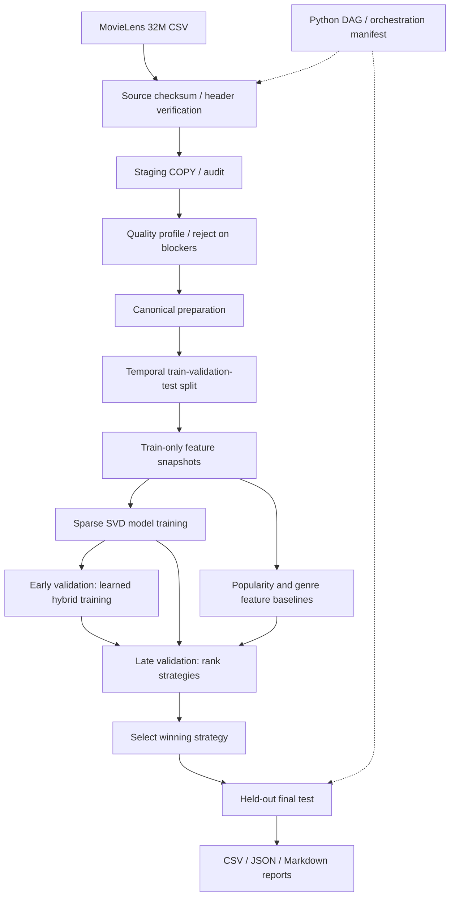

# Pipeline architecture — 2025AG05135

This implementation uses PostgreSQL for transactional/audited ingestion,
referential constraints, versioned features, and experiment tracking.
The `src/cinematch` package is the single implementation source; stage
interface modules in `src/<assignment-stage>/pipeline.py` preserve the
assignment's required navigable directory layout without code duplication.

## Flow

No tag-based NLP model is used. Raw interaction truth is limited to the
proper partition for each training or evaluation step.
